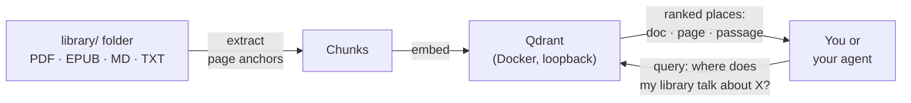

<p align="center">
  
</p>

<p align="center">
  [](https://github.com/marcosconci1/library-query/actions/workflows/tests.yml)
  [](LICENSE)
  
</p>

<p align="center">
  <b>A semantic locator for your document library.</b> Ask a question in natural language and get back where the answer lives: the document, the page, and the matching passage. It finds places; it never writes answers.
</p>


Reading is not the bottleneck. Finding is. The books, papers, and article
transcripts pile up as PDF and EPUB files on a disk somewhere, and every
question ("where did I read about X?") becomes a manual hunt through
filenames and half-remembered titles. The documents exist but stay opaque
to their owner and to any AI agent working alongside them.

library-query indexes a folder of raw documents into a vector store and
answers questions with ranked locations: source document, page or section
number, and the matching text. It is a locator by design. It returns
evidence you can open and verify, not prose that pretends to know. Any
coding agent can call it from the terminal the way it calls `grep`, and
cite real pages instead of guessing.

The result: a private, self-hosted search layer over the reading that
already exists. One Docker container, one folder of documents, one
command to index, one command to ask. Your files never leave the machine;
only chunk text goes to the embeddings endpoint you configure.



## How it works

1. **Extract** turns each supported file (`pdf`, `epub`, `md`, `txt`) into
   chunks with source anchors: 1-based page numbers for PDF, section
   anchors for EPUB.
2. **Embed** sends each chunk through an OpenAI-compatible embeddings
   endpoint (default: `openai/text-embedding-3-small` via OpenRouter).
3. **Store** writes the vectors to a local Qdrant container. Point IDs are
   deterministic, so a retried index overwrites partial writes instead of
   duplicating them. A content-hash ledger tracks what changed, so
   re-indexing skips untouched files.
4. **Query** embeds the question and returns ranked places: document,
   page or section, and the matching chunk text. Retrieval only. No answer
   generation, ever.

## Quick start

```bash
git clone https://github.com/marcosconci1/library-query
cd library-query
uv sync
cp .env.example .env        # point LIBRARY_ROOT at your documents folder
docker compose -f docker/docker-compose.yml up -d
uv run library-query index
uv run library-query query "where does my library talk about X?"
```

An agent can call the same two commands:

```bash
library-query index
library-query query "what does my library say about X?"
```

## Documentation

- [Installation](docs/install.md): first run, environment, Qdrant setup,
  querying, and cache behavior
- [Library layout](docs/library-layout.md): how documents, metadata, and the
  optional Zotero catalog fit together

## License

MIT. See [LICENSE](LICENSE).
