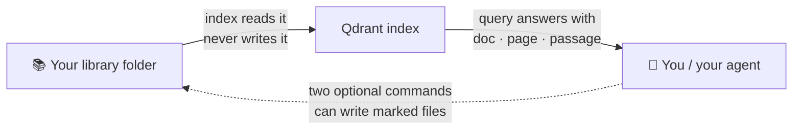

# Library layout

library-query reads any folder you point `LIBRARY_ROOT` at. It offers a
simple flat layout for getting started and a shelf layout for a curated
collection.



The whole deal in one line: **indexing and querying only read your
folder**. The only two writers are opt-in commands (`browse --write` and
`sync-zotero-notes`), and they touch only clearly marked files.

## Flat layout (simplest)

Put documents in one folder, in any depth. Every supported file under
`LIBRARY_ROOT` gets indexed:

```text
my-docs/
  paper-one.pdf
  books/
    some-book.epub
  notes.md
```

No metadata files are required. The document's filename is its identity.

## Shelf layout (organized collection)

A shelf layout separates documents, metadata, and generated files:

```text
library/
  Books/            # books, one folder per item
  Papers/           # papers and articles, one folder per item
  Videos/           # timestamped video transcripts
  Metadata/         # one <item_id>.md record per item
  Collections/      # curated subject indexes
  catalog.bib       # optional bibliography (BibTeX)
  _Inbox/           # staging area for new files
```

Each item folder holds the document plus an optional `README.md` with
your own notes (`subjects`, `status`, free text). `catalog.bib`, when
present, is metadata-only: bibliographic facts in it win over stale
README fields, but README notes stay yours.

## What the tool reads and writes

- **Reads**: documents, item READMEs, `catalog.bib`. Always safe.
- **Writes**: nothing by default. `browse --write` regenerates
  navigation blocks inside shelf `README.md` files and
  `Collections/subjects.md`. `sync-zotero-notes` writes annotation
  markdown produced by a Zotero export. Both are opt-in and overwrite
  only files carrying their generated-file marker.

## Zotero integration (optional)

If you manage references in Zotero, `catalog.bib` can be a Better BibTeX
export and the tool prefers its citation data. Everything works without
Zotero: the bibliography is one optional input, not a dependency.
